# Sayantan Bhattacharjee

### Undergraduate Engineering Portfolio | Electronics & Telecommunication Engineering

  <strong>About Me:</strong> I am a third-year undergraduate student pursuing B.Tech in Electronics and Telecommunication Engineering at <strong>Barak Valley Engineering College</strong>, affiliated with <strong>Assam Science and Technology University</strong>. My core technical interests and projects focus on Radio Frequency (RF) & Microwave Engineering, Antenna Design, Semiconductor Device Physics, and Python-based Signal Processing & AI Frameworks.

---

## Featured Projects

### 1. Active Resonant Tunneling Diode Integrated Microstrip Patch Antenna
* **Domain:** RF / Microwave Engineering & 5G Sub-6 GHz Communications
* **Key Focus:** Active antenna design integrating negative differential resistance (NDR) for gain enhancement.
* **Project Visuals:**
  *(Upload your images to the repository and name them like `project1_1.png`, then uncomment below)*
  <!-- 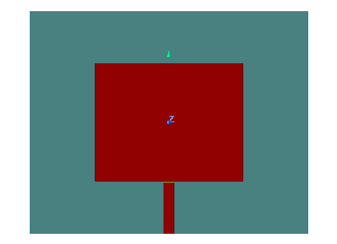 -->
  <!-- 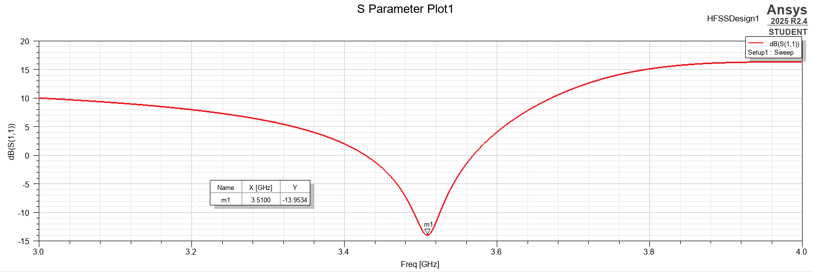 -->
  <!-- 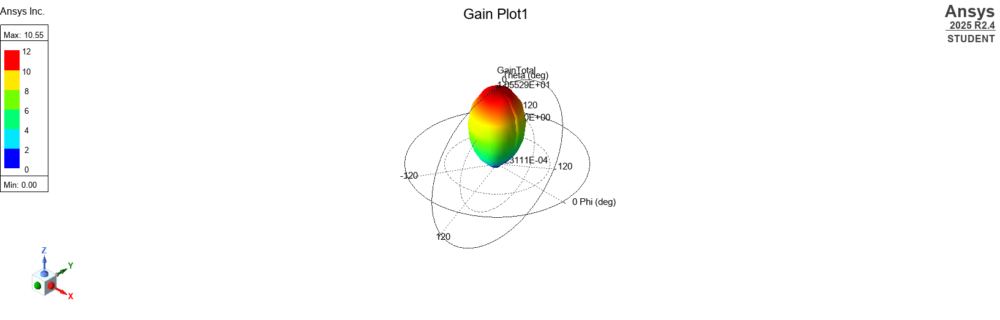 -->
  <!-- 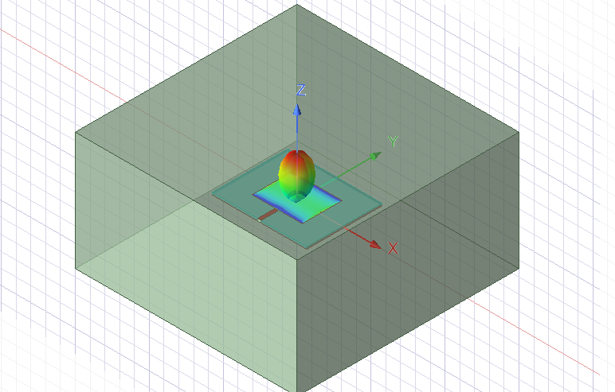 -->

---

### 2. Quad-Band Microstrip Patch Antenna Design for Multi-Standard Wireless Applications
* **Domain:** Antenna Theory & Multi-Standard Wireless Systems
* **Tools & Substrate:** Ansys HFSS, FR-4 Substrate
* **Key Innovation:** Successfully excited four distinct resonant frequencies at 2.96 GHz, 3.75 GHz, 5.00 GHz, and 6.83 GHz.
* **Return Loss (S11):** Ranged from -11.50 dB to -19.38 dB (comfortably below the standard -10 dB threshold).
* **Applications:** Suitable for S-band radar, C-band 5G Sub-6 GHz, and 5 GHz Wi-Fi communications.
* **Project Visuals:**
  <!-- 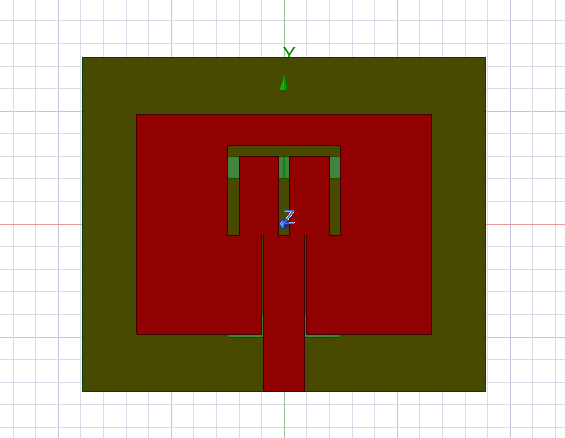 -->
  <!-- 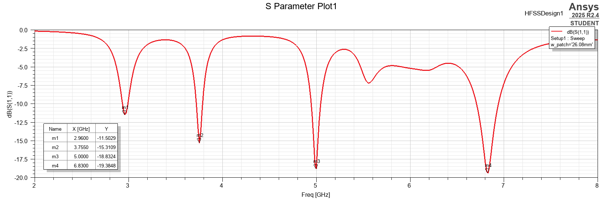 -->
  <!--  -->

---

### 3. Wideband Microstrip Patch Antenna for 5G Sub-6 GHz Applications
* **Domain:** Mid-band 5G Wireless Communication Networks
* **Tools & Substrate:** Ansoft HFSS, FR-4 Substrate
* **Key Metrics:** 
  * **Bandwidth:** 272.5 MHz
  * **VSWR:** 1.36 and 1.02 within the operational band.
  * **Peak Broadside Gain:** 1.64 dB
* **Project Visuals:**
  <!-- 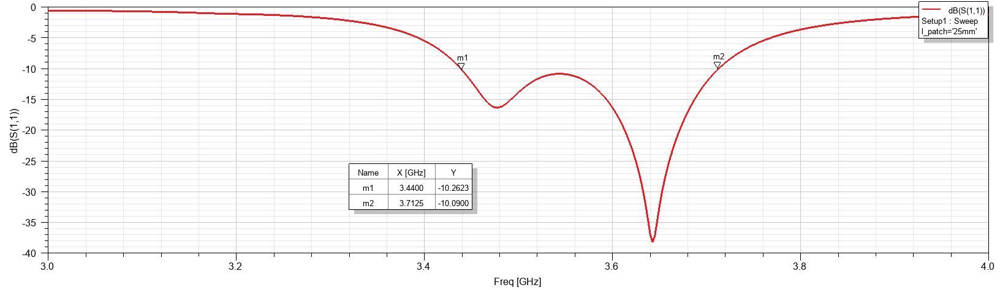 -->
  <!-- 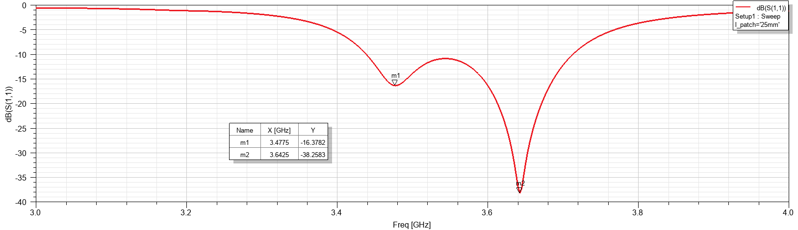 -->
  <!-- 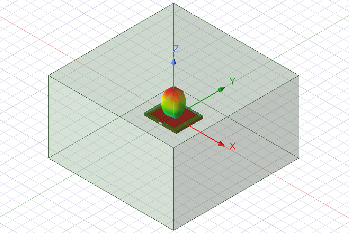 -->

---

### 4. Radar Pulse Compression & Matched Filtering Simulation
* **Domain:** Digital Signal Processing (DSP) & Radar Systems
* **Tools:** Python, NumPy, Matplotlib
* **Key Innovation:** Developed a complete DSP simulation to model radar target detection and range estimation. Generated a high-energy Linear Frequency Modulated (LFM) chirp signal adhering to the Nyquist sampling theorem, introduced simulated target echo delays, and flooded the channel with Additive White Gaussian Noise (AWGN) before implementing a time-reversed matched filter using convolution to extract the hidden signal.
* **Project Visuals:**
  <!-- 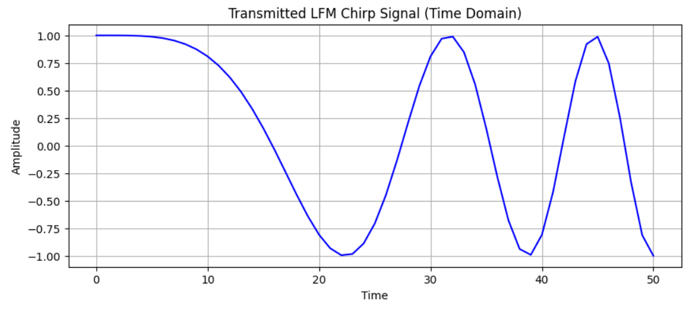 -->
  <!-- 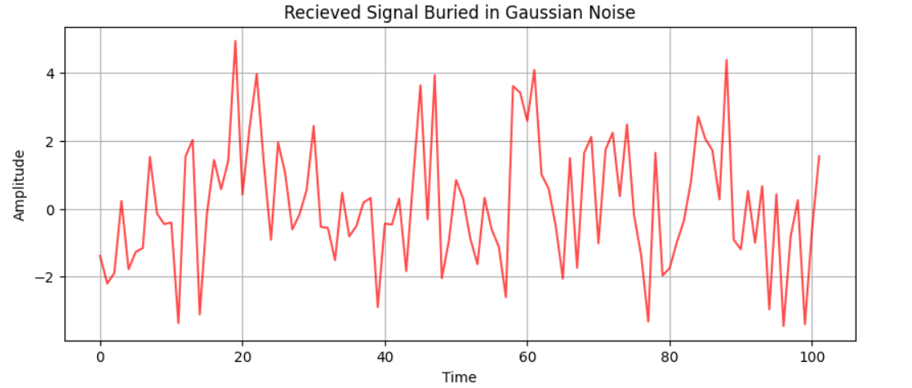 -->
  <!-- 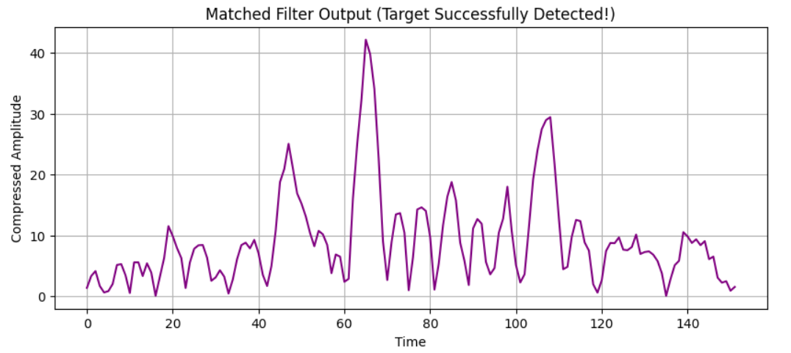 -->

---

### 5. A High Bandwidth 3.5 GHz Patch Antenna Design Using Precise FR4 Modeling
* **Domain:** RF Engineering & Bandwidth Enhancement for Sub-6 GHz 5G
* **Tools & Substrate:** Ansys HFSS, FR-4 Substrate
* **Key Innovation:** Leveraged rigorous analytical modeling and iterative substrate analysis to push standard FR4 capabilities to their limits.
* **Key Metrics:**
  * **Bandwidth Expansion:** 110 MHz (more than double the 50 MHz achieved in standard designs).
  * **Resonant Frequency:** 3.5025 GHz
  * **VSWR:** 1.51
  * **Return Loss (S11):** -13.83 dB
  * **Gain:** 3.98 dBi
* **Project Visuals:**
  <!-- 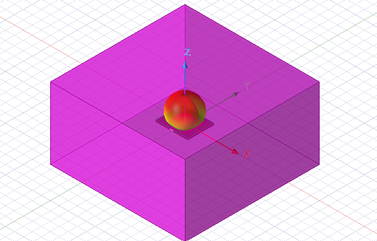 -->
  <!-- 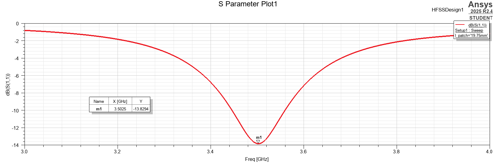 -->
  <!-- 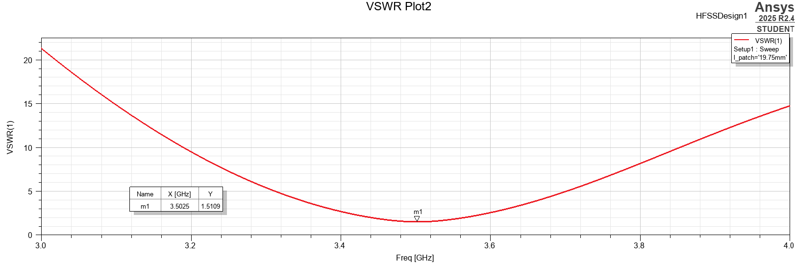 -->

---

### 6. Prediction of Security Threats using AI-based Wireless Sensor Network
* **Domain:** AI-driven Security Framework for IoT & WSN
* **Tools:** PyTorch, Time-Series Transformers
* **Key Innovation:** Built a temporal threat detection pipeline using a custom PyTorch Time-Series Transformer to detect cyber-physical threats in real-time.
* **Mechanism:** Analyzes raw sensor telemetry to establish an operational baseline, compares live data against dynamic statistical thresholds (μ + 3σ), and flags severe deviations (such as False Data Injection Attacks, node tampering, or DoS battery drain) as Security Alerts.
* **Project Visuals:**
  <!-- 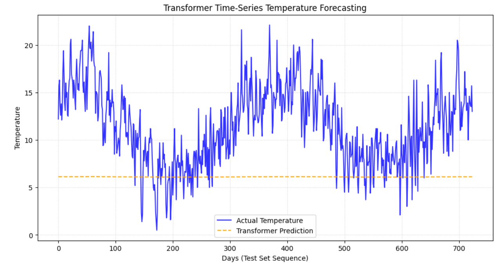 -->
  <!-- 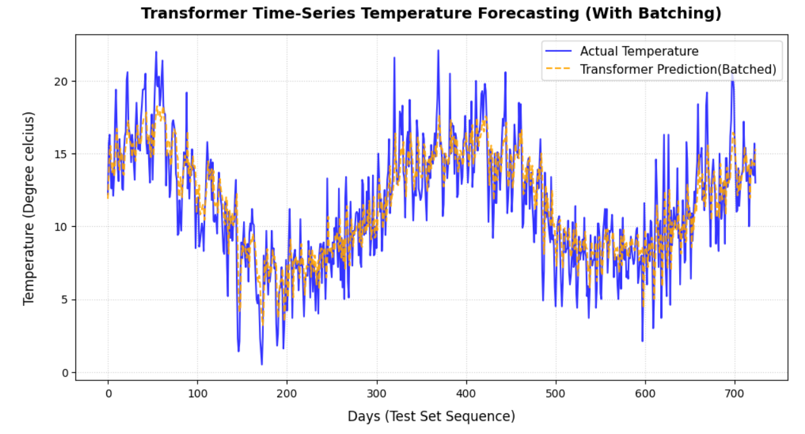 -->
  <!-- 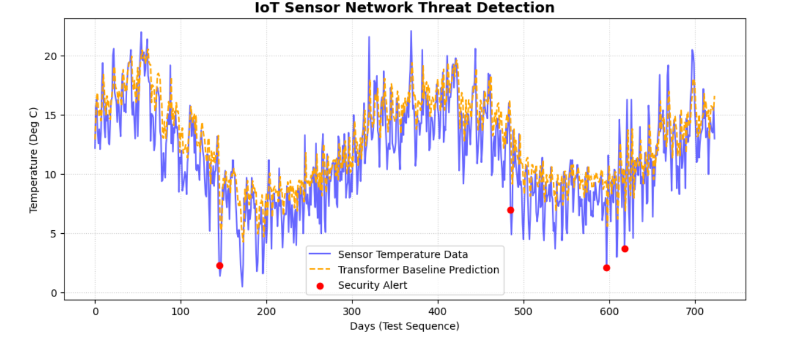 -->

---

### 7. High-Performance Microstrip Patch Antenna Design on Rogers RT/Duroid 5880
* **Domain:** Next-Generation Wireless Systems & Long-Range Communication
* **Tools & Substrate:** Ansys HFSS, Rogers RT/Duroid 5880 Laminate (tan δ ≈ 0.0009)
* **Key Innovation:** Minimized substrate losses and maximized overall directivity using low-loss laminates.
* **Key Metrics:**
  * **Resonant Frequency:** 3.52 GHz
  * **Return Loss (S11):** -18.99 dB
  * **VSWR:** 1.25
  * **Peak Gain:** +8.09 dBi
* **Project Visuals:**
  <!-- 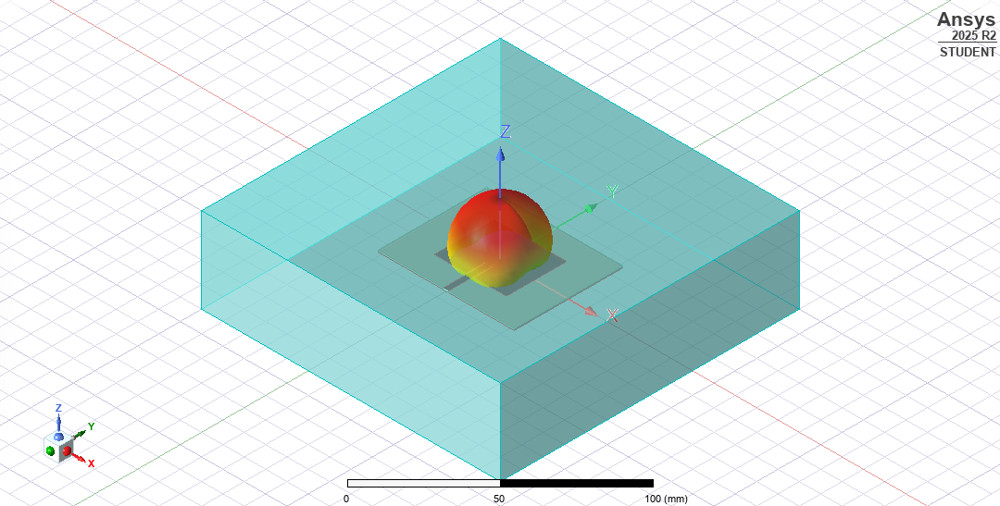 -->
  <!-- 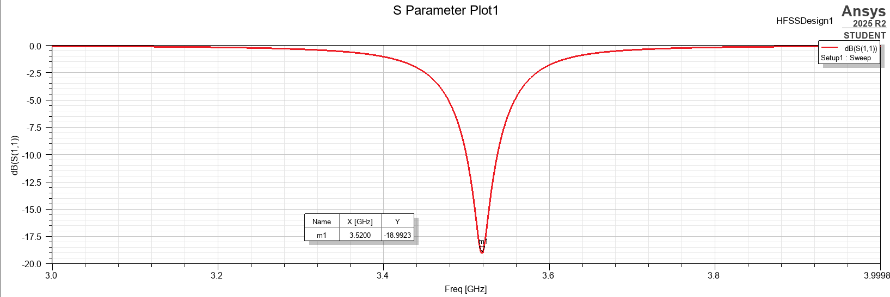 -->
  <!-- 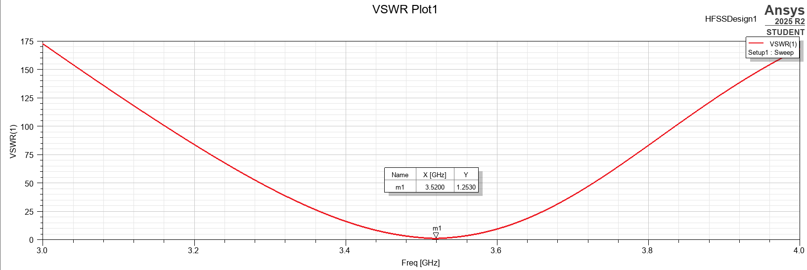 -->
  <!-- 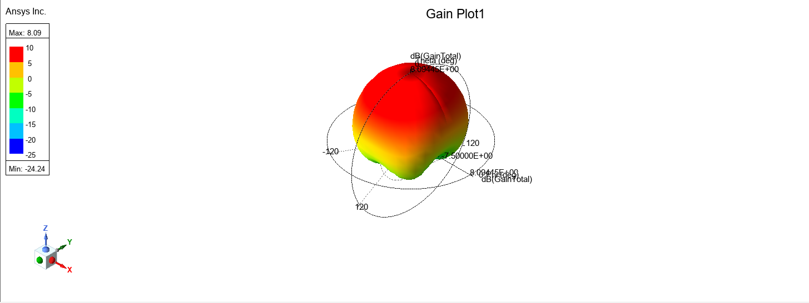 -->

---

### 8. Design and Iterative Optimization of a 5G Sub-6 GHz Antenna on FR4
* **Domain:** Cost-Effective, Commercial-Grade Substrate Design
* **Tools & Substrate:** Ansys HFSS, FR-4 Substrate (tan δ ≈ 0.02)
* **Key Innovation:** Engineered a well-matched configuration for budget-conscious wireless hardware through careful dimensional tuning and feedline adjustments despite higher dielectric losses.
* **Key Metrics:**
  * **Resonant Frequency:** 3.4975 GHz
  * **Return Loss (S11):** -12.2 dB
  * **VSWR:** 1.65
  * **Peak Gain:** +4.29 dBi
* **Project Visuals:**
  <!-- 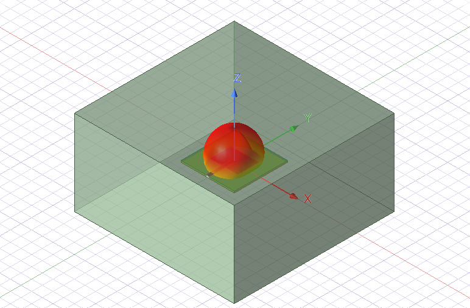 -->
  <!-- 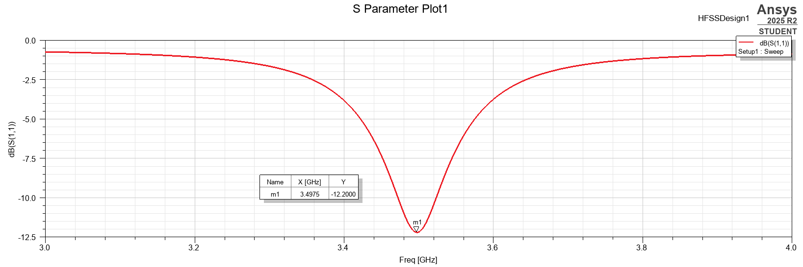 -->
  <!-- 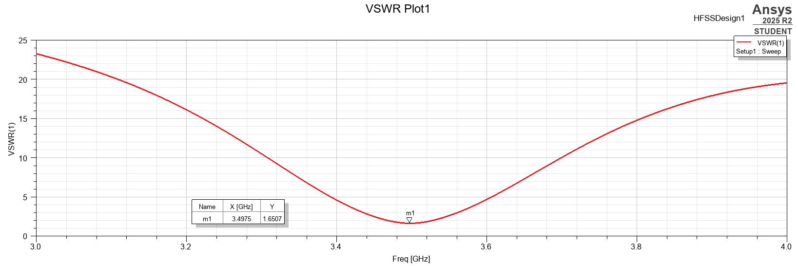 -->
  <!-- 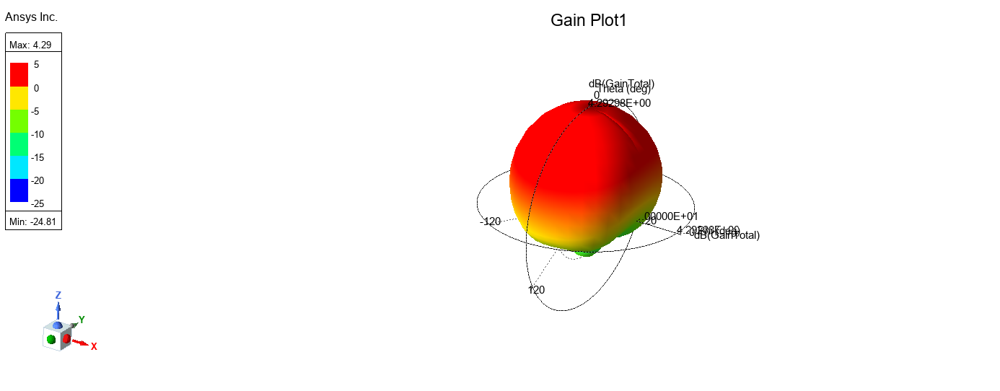 -->
  

---

## Technical Skillset

* **RF & Antenna Engineering:** Antenna Design, RF Simulation, Ansys HFSS, Electromagnetic Waves
* **Semiconductor Physics & Devices:** Physics of Semiconductor Devices, Electronic Devices, Advanced Bipolar Transistors, Advanced Field Effect Transistors, Quantum Mechanics
* **Circuit Design & Simulation Software:** Proteus Software, LTspice Software
* **Core Electronics & Mathematics:** Analog Electronics, Digital Electronics, Differential Equations, Partial Differential Equations
* **Programming & Signal Processing:** Python, Signal Processing, NumPy, Matplotlib, PyTorch
